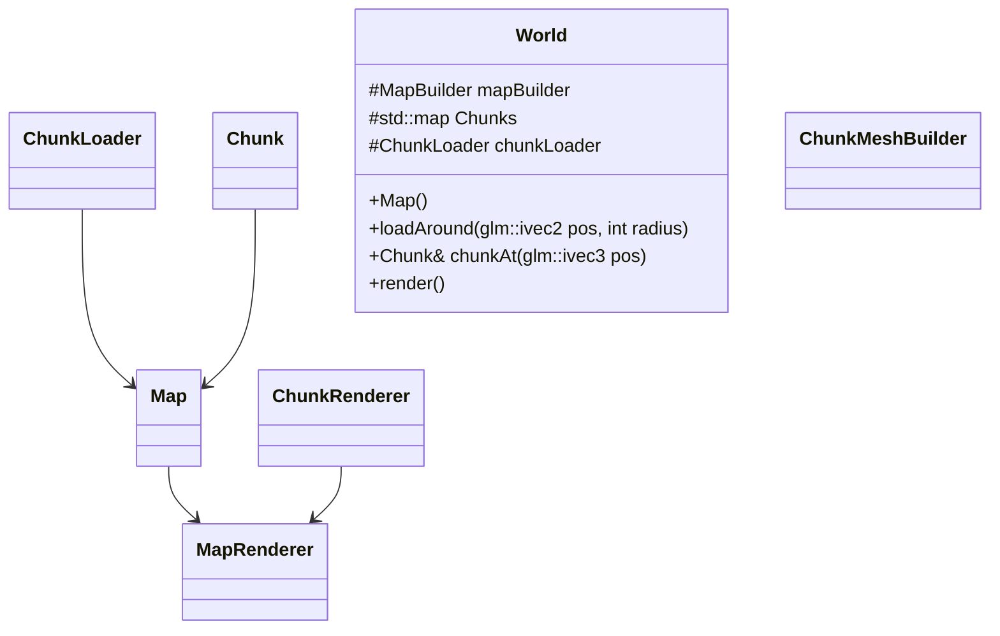

# Global architecture

## World

### WorldRepository

### World

        #MapBuilder mapBuilder
        #WorldRepository m_worldRepo
        #std::map<glm::ivec2, Chunk> Chunks
        #ChunkLoader chunkLoader
        +Map()
        +loadAround(glm::ivec2 pos, int radius)
        +Chunk& chunkAt(glm::ivec3 pos)
        +render()
    }
 

    class WorldRepository {
        #std::unordered_map<glm::ivec2> chunks
    }

    class Chunk {

    }

    class ChunkRenderer {

    }

    class ChunkMeshBuilder {

    }

    class Player {
        
    }

