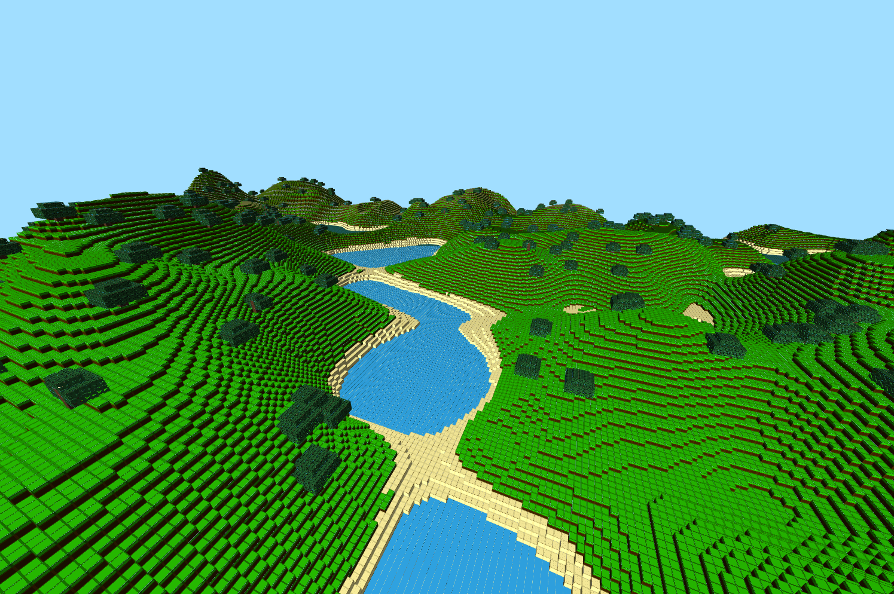
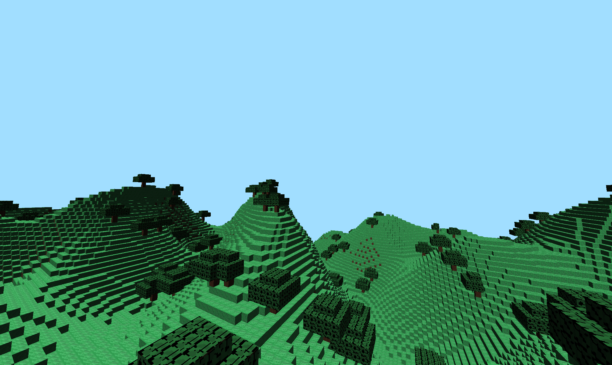
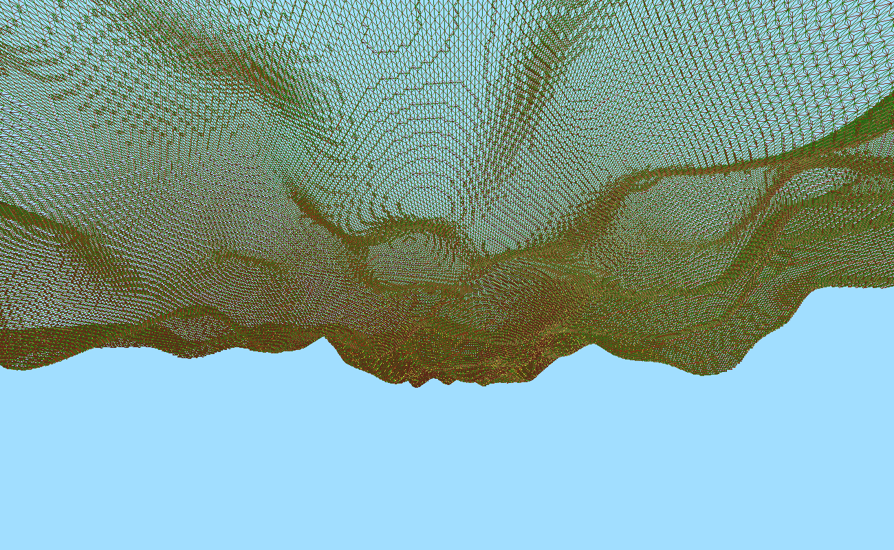
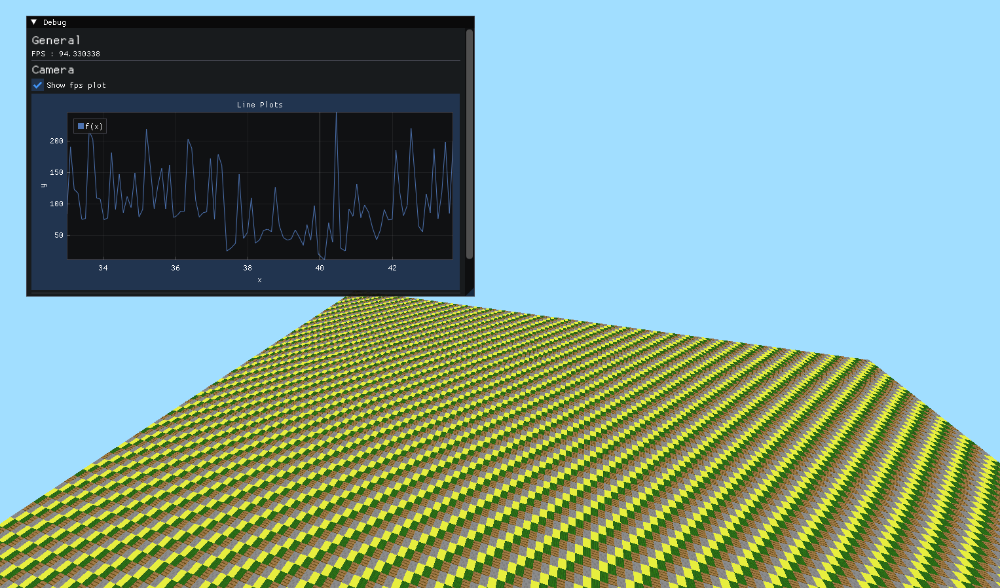

# A repo to Learn OpenGL while creating a minecraft like game




## Week 5







## Week 3


## Week 1


## To-do

- [x] des textures
- [x] des chunks, un renderer de chunk etc...
- [ ] des niveaux de détail
- [ ] configuration : des inputs, des gamemode...
- [ ] implémenter une classe d'entrée pour faire des entrées propres qui
      appellent correctement la translation de la camera
- [x] un générateur de chunks type bruit de perlin
- [ ] la gravité et la détection des collisions
- [ ] une interface
- [ ] des beaux shaders pour l'eau, le ciel etc.
- [ ] des arbres, des structures aléatoires...

## Set-up for dev

Cmake is set to automatically expose `compile_commands.json` in the build
directory. You then just configure clangdlike that :

```
CompileFlags:
  CompilationDatabase: "build"
```

## Test running

Set-up build directory:

```bash
cmake -B build . -DCMAKE_BUILD_TYPE=Release -DBUILD_TESTS=ON -S .
```

Build

```bash
cmake --build build --parallel 12 --target test_learnopengl
```

Then

```bash
cd build && ctest
```


# Thanks

This project is very thankfull to these libraries:

_always check if the license written here is the correct one, I might have done some mistakes_

- *glm* (https://github.com/g-truc/glm - The Happy Bunny License or MIT license) for the linear algebra and matrices
- *glfw* (https://github.com/glfw/glfw - Zlib license) for the window creation and OpenGL context creation
- *glad* (https://github.com/Dav1dde/glad - MIT license) for the loading of OpenGL
- *dear imgui* (https://github.com/ocornut/imgui - MIT License) for the debug ui, windows and tools
- *spdlog* (https://github.com/gabime/spdlog - MIT License) for the debugging and logging messages
- *implot* (https://github.com/epezent/implot - MIT License) for the plotting in egui windows

Those specifications:

- *The Khronos specification* (Apache-2.0 license) (from glad)
- *The EGL specification* (Custom license found here : https://github.com/Dav1dde/glad/blob/glad2/LICENSE) (from glad)

Those software:

- *tracy* (https://github.com/wolfpld/tracy - 3-clause BSD license) for the profiling and performance analysis of this piece of code.
- *firefox* (https://www.firefox.com/ - Mozilla Public License and more - https://www.mozilla.org/credits/) as a browser to browse the c++ reference or other documentation
- *linux* (https://kernel.org/ - GNU GPL v2 but read the source for more details - partial crediting at https://www.kernel.org/doc/linux/CREDITS) as the kernel of fedora
- *fedora* (https://fedoraproject.org/ - MIT compilation license, more information at https://docs.fedoraproject.org/en-US/legal/fedora-linux-license/) as an operating system for my computer
- *git* (https://git-scm.com/ - GPL-2.0-only) for version control 
- *fogejo* & *codeberg* (forgejo.org - GNU GPLv3 - codeberg.org) as a service to hold git and an interface for the project management
- *cmake* (https://gitlab.kitware.com/cmake/cmake - BSD 3-Clause New) as a build system
- *gcc* & *gdb* (https://gcc.gnu.org/ - GPLv3+ but look into it for details as it is a big project) for compiling c++
- *clang and LLVM project* (https://clang.llvm.org/ -	Apache 2.0 with LLVM) for compiling c++
- *helix editor* (https://github.com/helix-editor/helix - Mozilla Public License Version 2.0) for editing code
 

Without which I would have a hard (or long ?) time programming a replacement for these !
Thank you to all, and the ones that I might have forgotten !

