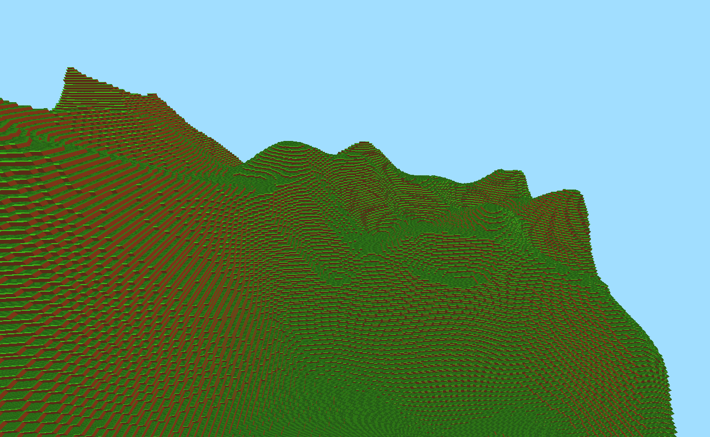

# A repo to Learn OpenGL while creating a minecraft like game

## Week 1


## Week 3


## Week 5



## To-do 

- [x] des textures
- [x] des chunks, un renderer de chunk etc...
- [ ] des niveaux de détail
- [ ] configuration : des inputs, des gamemode...
- [ ] implémenter une classe d'entrée pour faire des entrées propres qui appellent correctement la translation de la camera
- [x] un générateur de chunks type bruit de perlin
- [ ] la gravité et la détection des collisions
- [ ] une interface
- [ ] des beaux shaders pour l'eau, le ciel etc.
- [ ] des arbres, des structures aléatoires...


## Set-up for dev

Cmake is set to automatically expose `compile_commands.json` in the build directory. You then just configure clangdlike that :
```
CompileFlags:
  CompilationDatabase: "build"
```

## Test running
Set-up build directory:
```bash
 cmake -B build . -DCMAKE_BUILD_TYPE=Release -DBUILD_TESTS=ON -S .
```
Build 
```bash
 cmake --build build --parallel 12 --target test_learnopengl
```
Then 
```bash
cd build && ctest
```
