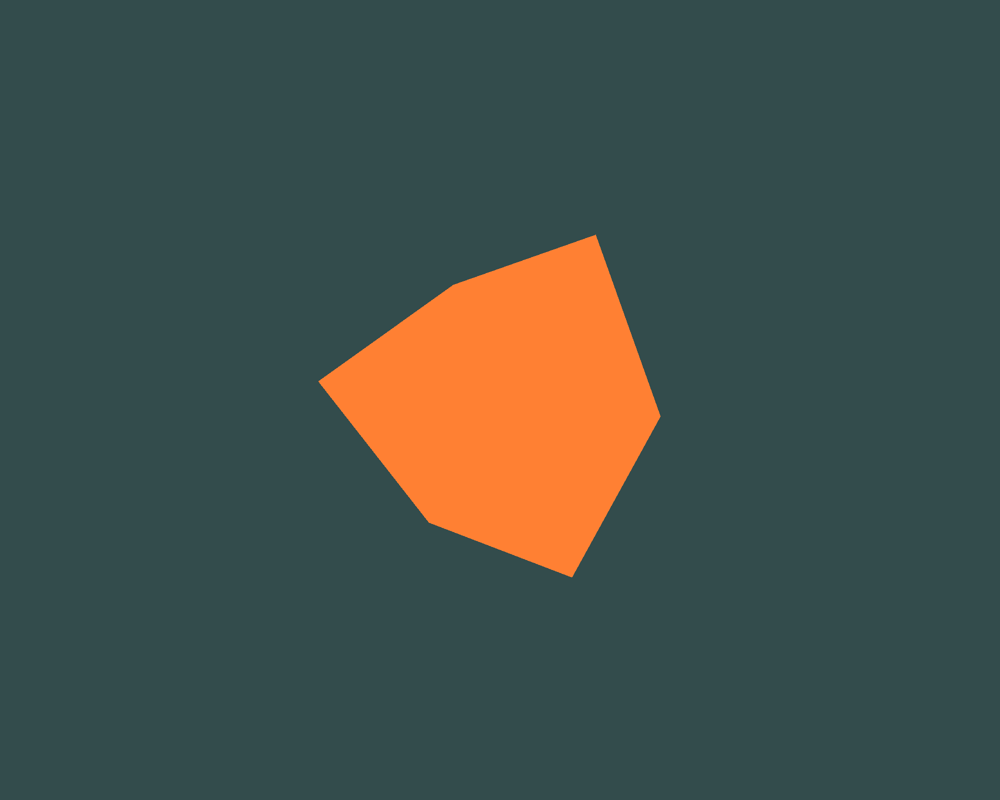

# Mon repo qui me permet d'apprendre à coder en OpenGL

## Semaine 1

## To-do 

- [ ] implémenter une classe d'entrée pour faire des entrées propres qui appellent correctement la translation de la camera
- [ ] translation verticale (haut/bas avec shift/espace)
- [ ] configuration des inputs, etc..
- [ ] un générateur de chunks
- [ ] des textures
- [ ] la gravité et la détection des collisions
